#### Basic definition

Kernel function K:X×X→R is essentially a bivariate function.

Specifically, we may use a PSD kernel function, which is symmetric and positive semidefinite (inner product in linear algebra).

positive semidefinite: 

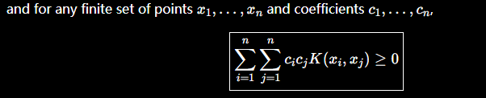
For a matrix K, any vector c satisfies: Kc ≥ 0.

#### Gaussian process(GP)

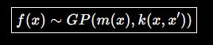
Joint probability density function:

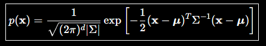
What is a Gaussian process? Essentially, it is a collection of random variables indexed by a continuous domain (time or space), where the random variable at each time or spatial point follows a Gaussian distribution.

Each GP is uniquely defined by a mean function m(x) and a covariance function k(x,x')

Here covariance function is also called kernel function(PSD).

Reason：

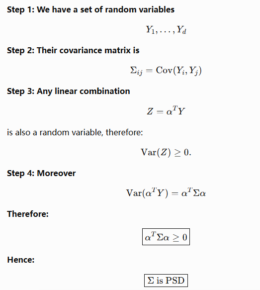

For a Gaussian process, the mean function is usually less important and can be set to 0.

Through f(x)=m(x)+g(x), we can easily analyze the Gaussian distribution of g(x) separately.

Therefore, the covariance function/kernel often plays a more dominant role.

##### 

##### Kernel in GP

###### kernel type

In GP, the choice of kernel needs to be based on our prior judgment about the data. If the function is relatively smooth, the RBF kernel/Gaussian kernel is the most commonly used:

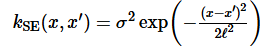
Here, the length scale l controls the amplitude. If l becomes smaller, the correlation between two points becomes stronger and the function varies more sharply.

sigma controls range，即average distance of function from mean which is simply scale.

The Rational Quadratic kernel is very similar to the Gaussian kernel and can be viewed as a sum of Gaussian kernels with different length scales. Compared with the former, it has greater multi-scale flexibility.

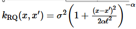

As its name suggests, the Periodic kernel is mainly used for data with clear periodicity, such as data whose frequency of seasonal variation is approximately consistent from year to year.

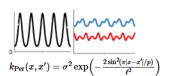

###### kernel combination

A single kernel is often unable to describe the data accurately, so we need to consider combinations of multiple kernels:

**Mutiplication**：Assume kernel multiplication as AND operation，i.e. reult will only have high value if both of the base kernel has high value.

such as Locally periodic kernel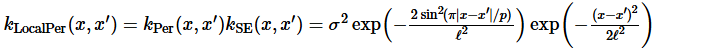

That is, while periodicity is preserved, the period may change over time. These two properties need to be combined, so multiplication is used.

**Addition**：Assume kernel addition as OR operation。i.e.if you add together two kernels, then the resulting kernel will have high value if either of the two base kernels have a high value.

For kernel selection, we often make a choice based on the given data, but this is often not sufficiently accurate. We can use various methods to make the selection more precise.

##### Gaussian process regression（GPR）

As a kind of ML, the covariance function serves as the prior, which means that we need to choose a specific kernel function k as prior information about the distribution.

For any kernel function, we have hyperparameters that need to be trained from the dataset.

For example, in the Gaussian kernel, we need to train for σ and l.

Here we use the marginal log marginal likelihood of a Gaussian distribution:

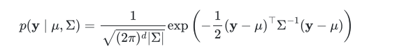

where theta is a vector carrying all hyperparameters and y is the observed data in (x,y).

Finally, we want to make a prediction of y2 based on x2. We also need to use the previously observed data point (x1,y1).

posterior distribution：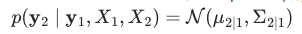

Posterior: using the existing data to infer the original function.

#### 

#### SVM

Unlike the use of the kernel function in GP, the kernel in SVM is no longer used to express the relationship between two points, but is extended to the kernel trick for dimensional lifting.

The problem faced by SVM: the data cannot be separated by a linear classifier.

Solution: map the low-dimensional data to a high-dimensional space through a feature map, and find a linear classifier in the high-dimensional space.

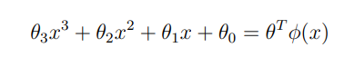
##### 

##### kernel trick in linear algebra

We have been emphasizing two particularly important properties of kernels: symmetry and PSD. In GP, our starting point is to analyze the covariance between two points, but here we approach the problem from the perspective of linear algebra.

Given a symmetric matrix A, we can obtain eigenvectors corresponding to different eigenvalues that are orthogonal. By spectral decomposition, we can obtain an orthogonal matrix Q, whose columns are eigenvectors:

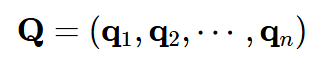
Then matrix A can be representged as：

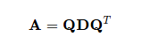
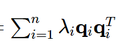
At the same time, {q_i} also forms an orthogonal basis.

Next, we need to connect these ideas with the kernel function. However, a matrix is a discrete representation, while a function is relatively continuous. How can we establish a connection between them?

The answer is that we treat f(x) as an INFINITE VECTOR. For a bivariate function K(x,y), the x and y coordinates correspond naturally to the row and column positions in a matrix, respectively:

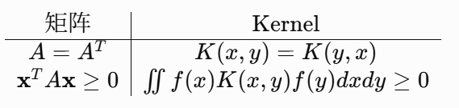
Similarly, in the matrix setting, the eigenvalues we use are replaced here by eigenfunctions (the Sturm–Liouville problem). By converting the summation into an integral, the symmetry of the kernel function likewise allows us to conclude that any two eigenfunctions are orthogonal.：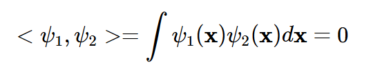

Similarly, the kernel function can also be written in the form of a series expansion.：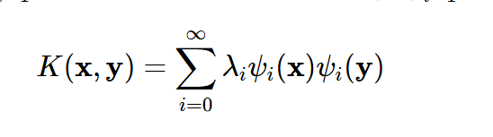

Which is super important Mercer Theorem：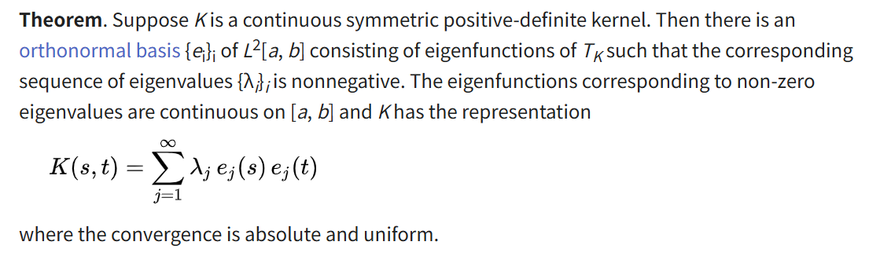

In short: if K(x,y) is a symmetric PSD kernel satisfying appropriate conditions, then it can be decomposed into a set of orthonormal eigenfunctions.

##### Kernel trick prove

Now that we have a powerful tool, Mercer theorem, let us see how to use it in what follows.

Whether it is the orthogonality condition we already have or the final form of the kernel trick, everything relies on the inner product. Therefore, we need to decompose the kernel function into an inner-product form so that it can operate in an inner product space. At the same time, we need to provide completeness because, as we previously treated the kernel function as an infinite matrix, the orthogonal basis here must also be infinite-dimensional, and completeness guarantees convergence.

Therefore, we construct a Hilbert space H: any function can be represented as:

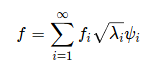where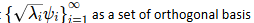

Therefore, in this Hilbert space:

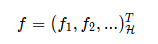
Considering that the kernel function is a bivariate function, we fix one parameter each time:

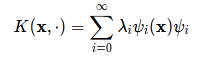
For this univariate function, its f_i is given for all i, so we can also organize it into a vector form in the Hilbert space:

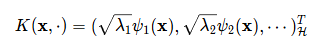
Then the inner product of two vectors in this Hilbert space can be written as:

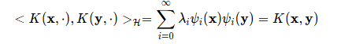
At this point, we have proved that this Hilbert space has an important property: the reproducing property.

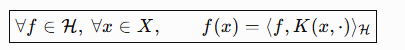
When the kernel function satisfies symmetry and PSD, we can construct a Hilbert space satisfying the reproducing property, namely an RKHS.

Finally, we return to the essence of the kernel function in SVM. We want to find a linear regression after the feature map, but the dimension after the feature map is too high, which makes the computation complicated. However, by rearranging the expression, the high-dimensional computation can be reduced to the following inner product:

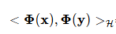
Then we define:

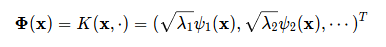
Then the inner product of the feature maps naturally becomes:

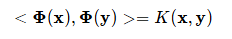
This process is what we call the Kernel trick.

But in fact, we do not need to know the underlying mechanism here. We only need to know that through the kernel trick, we can represent the relationship between x and y in a high-dimensional space, and this relationship allows us to compute their linear regression in the high-dimensional space.

Finally we can conclude that：

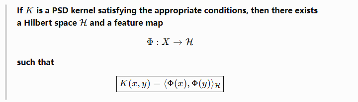
As for when to choose which kernel function in SVM, the situation is somewhat similar to GP. We still need to make a general judgment about the data; for example, data that is originally locally linear may require a linear kernel.

#### A kernel Two-sample test

##### Intro

Here we want to study how to compare samples from two **probability distributions.**

We set H0 (null) as distribution p being equal to distribution q.

Ha (alternative) as distribution P being different from distribution q.

So how exactly do we do this?

1. We need to find a function such that the points from p have larger values under the function, while the points from q have smaller values under the function.

2.Choose difference btw the mean function E(x) values on two samples 作为 test statistic, which is   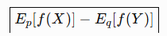

If this value is large, it suggests that the samples may come from different distributions.

(Here is a question: why do we choose a function that makes their difference large rather than small? The answer is that finding only one function for which they are the same cannot prove p=q, whereas finding one function for which they are different can prove p≠q (a counterexample).)

This test statistic is called the **Maximum Mean Discrepancy (MMD).**

Therefore, the most important variable in this method is the choice of the function f. Since we are taking a maximum, we must search within a certain range, so we need a reliable function class F.

The choice of this function class is based on two criteria:

1. 1. The function class must be “rich enough” to ensure that MMD is equal to 0 only when p=q.

2. 2. It must be “restrictive” enough to ensure that the convergence rate is not too slow.

Then how do we find a suitable function class under these conditions? We need to use the **unit ball in RKHS.**

Why it satisfies the above conditions will be discussed later.

##### MMD

x and y are random variable on Topological space 

X := {x1,..., xm},Y := {y1,..., yn},independently and identically distributed (i.i.d.) from p and q

Borel probability measures p and q

We first need to give the complete derivation of MMD.

Our starting point is: given samples from p and q, how can we determine whether they come from the same distribution?

We need a criterion:

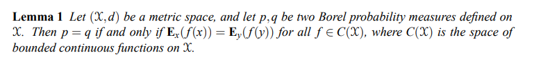
In concise terms, among all bounded continuous functions, if the means under the two distributions are the same, then the two distributions must be identical. This is also a necessary and sufficient condition for proving that two distributions are equal.

However, C(X) is obviously too large here. It is sufficiently rich, but it is not restrictive.

Following this idea, if equal means allow us to conclude that the distributions are identical, then the larger the difference between the means, the less similar the distributions should be, right?

So next we introduce MMD: it finds the function f in F that maximizes the difference between the means:

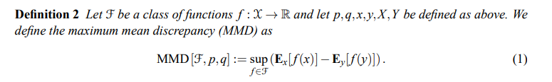
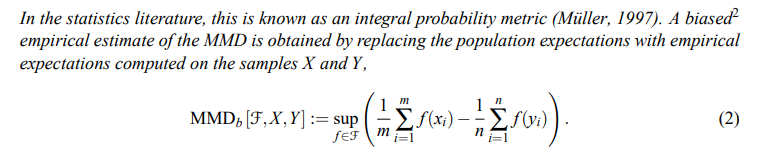
Note: the empirical estimate refers to the result estimated from actual data (unknown population), while the expression above is calculated from the true distributions (known).

##### mean embedding

After defining MMD, we need to find a suitable function space F:

As mentioned earlier, we need to use an RKHS here. But why? Looking at the MMD formula, finding the supremum over F would require repeatedly trying different functions, which is clearly a cumbersome computation. Is there a way to simplify this calculation?

We need to introduce the concept of **mean embedding**.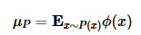：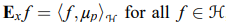（using reproducing property）

That is, we regard a distribution as an element in a Hilbert space:

At first glance, the mean embedding here seems somewhat similar to the feature map used in our SVM. Is it implicit here?

This turns the computation of MMD into a simple vector calculation. But before using this seemingly spontaneous mean embedding, what else do we need to do?

First, prove its existence:

Proof requires ***Riesz representation theorem：***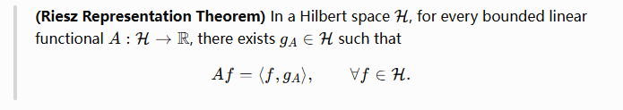

Put simply: if you have a sufficiently well-behaved linear operation T that maps a “vector” to a “number”, then it can actually be understood as taking the inner product of that vector with some fixed vector g_A.

Next, we need to prove that our linear operator E_x is bounded, using Jensen’s inequality:

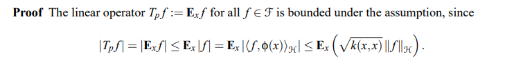
Therefore, we obtain the following lemma proving its existence:

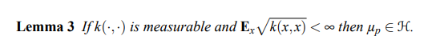

After proving that the mean embedding exists in a well-defined way, we can see how it helps us compute MMD:

For some subsequent calculations, we compute the square of MMD (Lemma 4).

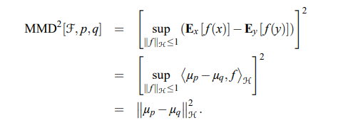

Use Cauchy-Schwarz.

This result looks particularly satisfying: we have obtained a metric in a Hilbert space.

Initially, we also wanted to compute the mean, but once again, using the **kernel trick**, we transformed this into computing the mean of the **“features”**, which is very similar to its application in SVM:

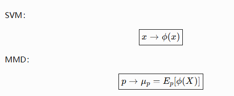

Here we need one additional restriction: the mean embedding under the RKHS must be **injective.**

This is obvious; otherwise, different distributions could have the same embedding, which would contradict our criterion.

However, this property is not satisfied by every RKHS, because an **RKHS is determined by its corresponding kernel function**. For example, a polynomial of degree 2 cannot distinguish between different **kurtoses**. In other words, just as in our choice of function class, our RKHS also needs to satisfy the condition of being “rich enough”.

Who can satisfy this condition?**A universal RKHS.** Universality requires that k(·,·) be continuous, and H be dense in C(X) with respect to the L∞ norm. (This is a property, not a particular RKHS.)

Well-known examples include the Gaussian and Laplace RKHSs we are already familiar with (both are actually **characteristic kernels**).

We need to prove that a universal RKHS has the injective property. The theorem is:

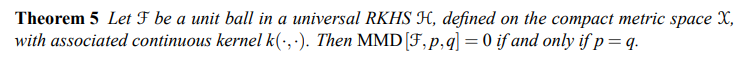
The proof is also relatively straightforward, requiring only some standard techniques from **metric space analysis**:

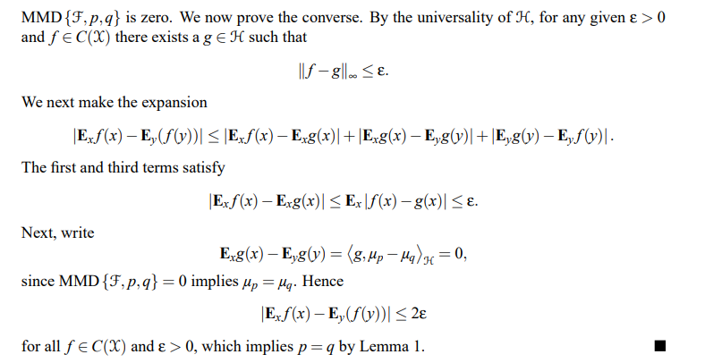
（forward direction obvious）The first step concerning the universality of HH is somewhat analogous to the **“RKHSversion of theWeierstrass approximation space”** that we encountered in functional analysis.

Next, we need to consider how to actually compute the MMD introduced in **Lemma 4**: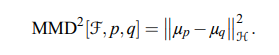

**Squared population MMD (theoretical calculation)**

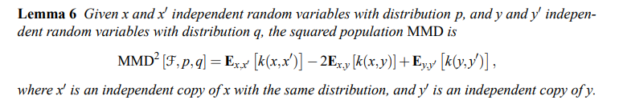

The proof is straightforward and only requires some basic knowledge of **linear algebra**: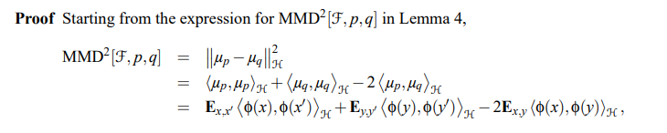

Finally, we use our favorite kernel trick:

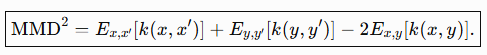

**Unbiased empirical estimate: (calculated from data)**

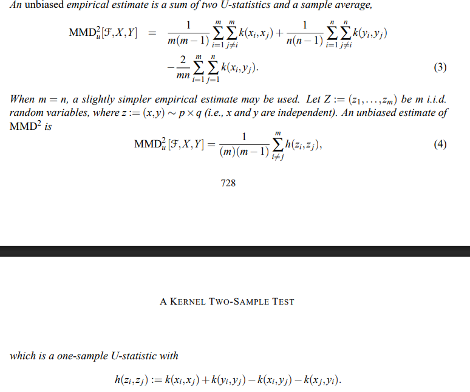

**Biased statistic:**

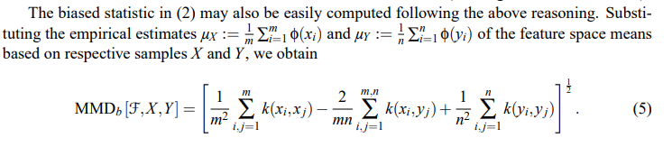

##### 

##### Witness function

Next, we come to the final step of this process. Since we have already found a way to maximize MMD, what exactly is the f that we have been looking for?

It is the Witness function of MMD for RKHS:

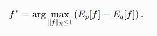

we define the witness function  to be the RKHS function attaining the supremum in (1), and its empirical estimate ˆto be the function attaining the supremum in (2).

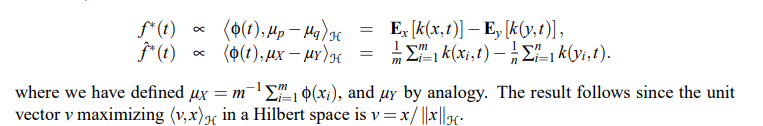

by kernel trick

Reference:

GP part: [https://peterroelants.github.io/posts/gaussian-process-kernels/](https://peterroelants.github.io/posts/gaussian-process-kernels/)

MMD part: A Kernel Two-Sample Test written by Arthur Gretton

